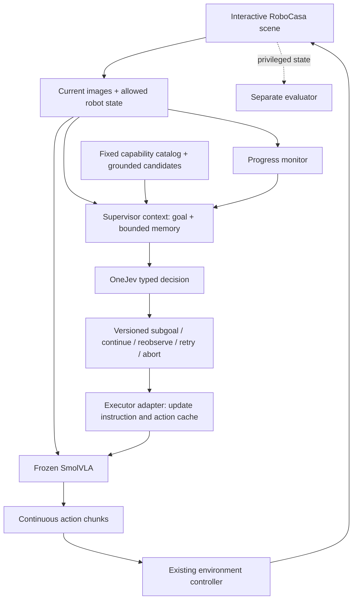

# Implementation plan: OneJev as a typed supervisor over a learned robot policy

**Version:** 2.0 — revised implementation direction  
**Review date:** 16 October 2026  
**Scope:** simulation-first, solo developer, reusable upstream components  
**Status:** implementation specification; combined integration has not yet been run or benchmarked.

> **Research question:** Does an image-conditioned typed-decision model improve subgoal selection, task completion and recovery when supervising an otherwise unchanged learned action policy?
>
> The goal is not to build a new VLA or replace learned manipulation with hand-written trajectories. Change the supervisor while keeping the executor and evaluation environment fixed.

## How to read this plan

- **REUSE** — upstream code/checkpoint exists; installation and compatibility still need testing.
- **ADAPT** — upstream implementation exists but its interface or assumptions differ.
- **BUILD** — project-specific integration or experimental controls.
- **LATER** — excluded from the first result.

Repository existence is not proof that the combined system runs, that assets are bundled, or that licences permit code reuse. Capture commits, checkpoint revisions, licences and dependencies before implementation.

## 1. Architecture change

```text
PREVIOUS TARGET
OneJev → grasp(object) → explicit grasp geometry → IK/path planning
       → trajectory tracking → outcome

REVISED TARGET
OneJev → supported subgoal → frozen learned action policy
       → action chunks → native simulator controller → outcome
```

| Previous emphasis | Revised decision | Reason |
|---|---|---|
| Build separate approach/grasp/lift/place controllers | Use one pretrained subgoal-conditioned policy where coverage permits | Test supervision rather than reimplement motor behavior |
| Implement application-level IK, OMPL and trajectory generation | Remove as project prerequisites | Learned executor supplies actions |
| Treat seven manipulation verbs as a universal skill vocabulary | Use subgoals at the granularity understood by the executor | A checkpoint may not support an isolated “lift” instruction |
| Train every skill separately | Initially freeze a shared multitask executor | Isolate the supervisor's contribution |
| Assume OneJev helps | Compare direct execution, fixed decomposition and generative supervision | Require measured benefit |

Learned action generation does **not** eliminate kinematics, feedback control or safety constraints. The executor may use IK or operational-space control internally. We are removing our own hand-designed motion-planning pipeline from the primary path, not deleting the robot's native controller. Classical planning remains a later option for a demonstrated safety or fallback need.

A skill is a conditional behavior, not necessarily a separate model file:

```text
policy(current observations, robot state, active subgoal)
    → chunk of continuous actions
```

Each supported subgoal needs an applicability condition, termination monitor and failure handling. A pretrained checkpoint does not automatically understand every instruction we invent.

## 2. Repository audit: what can be reused?

| Project | Reusable material | Decision and gap |
|---|---|---|
| [OneJev](https://github.com/OmniJev/OneJev) | Typed image-decision interface, inference backends, model/training code | **REUSE** inference; **BUILD** a supervisor adapter. No ready-made RoboCasa supervisor. |
| [LeRobot](https://github.com/huggingface/lerobot) + [RoboCasa guide](https://huggingface.co/docs/lerobot/main/robocasa) | Named pretrained SmolVLA RoboCasa checkpoint, observation/action mapping and evaluation path | **REUSE** as primary executor baseline; hierarchical handoff experiment still needs building. |
| [MemER](https://github.com/memer-policy/memer) | Deployment wrapper, structured-predictor interface, memory, camera layouts, data export and offline evaluation | **ADAPT** interface and memory ideas. Its low-level policy integration is not a ready OneJev/RoboCasa adapter. Check licence and dependencies before copying. |
| [RoboCombine](https://github.com/AutoLab-SAI-SJTU/RoboCombine) | Compositional task specs, runners, metrics, policy adapters and instruction-handoff tests | **ADAPT** handoff tests/evaluation structure. Its released policy adapters are not our exact stack; external assets/checkpoints are required. |
| [SkillNet](https://github.com/VIPL-VSU/SkillNet) | Skill-MoE, hierarchy tooling, LIBERO-Skill tasks and checkpoint references | **LATER**. It changes the executor, so it is a separate experimental axis, not a plug-in selector. |
| [Goal2Skill paper](https://arxiv.org/abs/2604.13942) | Subtask contracts, memory, verification and reflection design | **DESIGN REFERENCE**. No author-verified official code repository was confirmed in this audit. |

### MemER notes

The public MemER deployment exposes a `StructuredPredictor.predict(prompt, images)` boundary and a deployment wrapper with `reset(...)` and `step(...)`. This is a useful place to substitute a OneJev-backed predictor. Candidate IDs, probability logging and validation are our additions.

The inspected MemER package pins `lerobot==0.4.4`, while the inspected current LeRobot source identifies version `0.6.2` and requires Python 3.12+. Do not install both dependency sets blindly into one environment. Keep a separate reference environment or write a small adapter. No explicit licence was located in the inspected MemER root/package metadata; confirm permission before copying or redistributing source.

The MemER paper configuration and public checkpoint/configuration are not necessarily identical. Keep claims about the paper and claims about public code separate. Neither provides an automatically compatible RoboCasa supervisor.

### RoboCombine notes

RoboCombine usefully separates full-instruction execution, oracle hierarchical execution and predicted switching. It tests the important case where a new instruction arrives while actions are queued. Borrow the handoff semantics and metrics, not its entire runtime at first. Its documented runtime has external assets and policy-specific dependencies; one path includes cuRobo.

### SkillNet and Goal2Skill notes

SkillNet's skill-conditioned experts are relevant later, but switching to SkillNet changes the executor and confounds the first OneJev experiment. Goal2Skill's paper can inform subtask contracts and verification; do not describe its code as available until an official repository is confirmed.

## 3. Chosen stack

| Layer | Initial choice | Status |
|---|---|---|
| High-level model | OneJev 1.5 0.8B; consider `mradermacher/OneJev1.5-0.8B-GGUF:Q8_0` for local serving | Model/listing exists; exact local integration untested |
| Action policy | [`lerobot/smolvla_robocasa`](https://huggingface.co/lerobot/smolvla_robocasa) | Freeze after native smoke test |
| Simulation | RoboCasa + robosuite + MuJoCo using the checkpoint's native embodiment | Do not transplant weights to SO-101 by changing robot names |
| Runtime | OneJev service separate from simulator/executor environment | Contains dependency conflicts |
| Supervisor infrastructure | Project-owned adapter; MemER-compatible interface and bounded event/keyframe memory | Build; reuse code only after licence/compatibility review |
| Evaluation | Native task success plus separately logged selector/handoff metrics | Adapt RoboCombine's separation of selector, trigger and executor |

**Compute boundary:** use the Mac for development, source inspection, recorded-image tests and a supported OneJev service. Start simulation inference with one environment on a compatible Linux/CUDA machine. Measure memory before longer runs. Do not assume RoboCasa plus both models will fit or run well on a 16 GB Mac.

Do not initially install SkillNet's training stack, RoboCombine's Motus stack, a world model, Marble, custom IK/OMPL, or a new vision tower. Do not fine-tune either model before the frozen baseline works.

### End-to-end architecture



The low-level policy receives fresh observations using its original preprocessing; OneJev does not need to caption every frame. The supervisor changes a subgoal, not motor coordinates. Private simulator labels are for evaluation and must not silently enter the ordinary supervisor path.

## 4. Interfaces we must implement

These are proposed project contracts, not upstream API schemas.

### 4.1 Observation ownership

| Field | Supervisor | Executor | Evaluator |
|---|---|---|---|
| Current RGB views and capture/step IDs | Yes | Yes, native preprocessing | Yes |
| Native proprioception | Approved fields | Exact checkpoint input | Yes |
| Global goal | Yes | Direct-VLA baseline only; otherwise active subgoal | Yes |
| Event/keyframe memory | Yes, fixed across compared supervisors | Only if native policy supports it | Yes |
| Candidate descriptions and IDs | Yes | Selected instruction only | Yes |
| Hidden object poses/reference next subtask | No, except declared oracle runs | No new privileged input | Yes |

Use the actual downloaded checkpoint configuration as authoritative for camera names, state/action dimensions, normalization and controller mode. Do not infer vector ordering from prose.

### 4.2 Capability catalog and candidate builder — BUILD

A typed model chooses from supplied options; it does not automatically invent an unlimited action vocabulary. Each catalog entry records a supported instruction, executor ID, tested environment revision, applicability, monitor and action budget.

```yaml
capability_id: close_fridge
instruction_template: "Close the fridge."
executor_id: smolvla_robocasa_frozen
supported_environment_revision: "<record actual revision>"
applicability: "Fridge exists and state is within tested coverage."
monitor_id: fridge_closure_monitor
max_sim_steps: "<set from native horizon and trials>"
```

Build candidates from the task, declared catalog and permitted observations. Include `continue_current`, `reobserve`, `retry_current` and `abort` only with explicit meanings.

- Reobserve means collect another observation; it does not promise a new viewpoint unless an available action moves the camera.
- Retry invokes a supported policy behavior; it is not a magically learned recovery skill.
- Do not use hidden benchmark decompositions to supply the correct ordered plan in the main experiment.
- Do not expose simulator object names as visual detections. Log provenance for all candidates.
- Measure candidate coverage separately. A selector cannot choose a valid subgoal omitted by the builder.
- All compared supervisors receive the same candidates. Free-form candidate generation is deferred.

### 4.3 Typed supervisor — BUILD around OneJev inference

```yaml
decision:
  episode_id: episode_001
  observation_id: frame_214
  memory_version: 7
  candidate_set_id: candidates_12
  selected_id: close_fridge
  probabilities: {close_fridge: 0.72, continue_current: 0.18, reobserve: 0.10}
  model_revision: "<pinned model revision>"
  status: accepted
```

The numbers are illustrative. Validate option membership, IDs, freshness, finite probabilities and API errors. Never default to the first candidate on parse/API failure. Use a `Choice` for one complete subgoal decision, not independent verb/object/destination choices that can disagree. Parallel questions share the input context; one answer is not automatically visible to another question in the same request.

A OneJev-backed MemER adapter can implement `StructuredPredictor.predict(...)`, returning a subtask and optional keyframe nominations. Pass candidates/context explicitly; do not rely on undocumented prompt parsing. Log probabilities separately. Initially, keyframes can be selected deterministically at events rather than by the model.

### 4.4 Frozen executor and handoff manager — ADAPT

Proposed API:

```text
reset_episode(initial_observation)
set_subgoal(subgoal, instruction_version, switch_mode)
next_action(current_observation)
cancel(reason)
```

Required switching semantics:

1. Do not reset the physical environment between subtasks.
2. Update language input and invalidate cached language representations.
3. Choose one explicit action-cache policy: discard remaining actions on switch, or defer the switch until the current chunk ends.
4. Tag chunks with instruction versions; never execute old-version actions after an immediate switch.
5. Reset episode buffers on episode reset, not on every observation.
6. Do not mistake changing a task string for changing queued actions.

SmolVLA's action-selection implementation queues actions and obtains another chunk when the queue is empty. Use one queue owner—upstream or project-side—not two. Read `predict_action_chunk`, `select_action` and `reset` in the pinned source before implementing handoffs.

Preserve the original action mode and limits. Do not assume an all-zero action is a safe hold; a component may select a mode or command a gripper. On API failure, pause simulation or invoke a tested environment-specific stop behavior. A paused-simulation test evaluates decision quality, not real-time deployment.

### 4.5 Memory, monitor and evaluator — three separate owners

- **Memory manager:** stores observed events, recent frames and selected older frames. Every item has timestamp and provenance. No future frames or outcome labels enter current input.
- **Progress monitor:** returns `running`, `success`, `failed` or `unknown` from allowed observations. Model prediction is evidence, not physical truth.
- **Evaluator:** uses private simulator state to score the root goal and ordered subgoals. Its labels stay separate from model-reported progress.

Start selector experiments with a common oracle transition trigger for all supervisors; label runs **oracle-assisted**. Then replace it with the same non-oracle monitor for all supervisors. Evaluate OneJev's own progress judgments only as a separate variable.

Begin with bounded recent frames and event-selected keyframe references. MemER-style learned retrieval is an optional ablation, not a prerequisite. Keep long-running buffers bounded or disk-backed.

## 5. Implementation tickets in dependency order

### G0 — Run the unmodified executor

| Ticket | Work | Done when |
|---|---|---|
| 0.1 | Clone sources; record commits, model revisions, licences | `source_lock.json` and isolated environments exist |
| 0.2 | Install native RoboCasa stack using its documented dependency workaround | A valid scene renders and policy loads |
| 0.3 | Run `lerobot/smolvla_robocasa` on `CloseFridge`, no OneJev | Saved rollout, score, shapes and resource measurements |
| 0.4 | Evaluate several upstream atomic tasks | Capability table records successes and failures |
| 0.5 | Verify OneJev image input independently | Image changes affect choices; no text-only fallback |

A single successful rollout is an installation gate, not evidence of generalization. If atomic tasks fail, fix checkpoint/environment/preprocessing compatibility before adding a supervisor. Do not train around an integration bug.

### G1 — Establish learned-skill handoffs

| Ticket | Work | Done when |
|---|---|---|
| 1.1 | Implement `ExecutorAdapter` without changing weights | Reproduces single-task baseline |
| 1.2 | Add measured capability catalog | Each instruction has canonical-start coverage |
| 1.3 | Add versioned handoffs and action-cache policy | Test proves stale actions cannot cross an immediate switch |
| 1.4 | Choose a composite scene supporting at least two tested capabilities | Both execute in one continuous environment instance |
| 1.5 | Compare second subtask from canonical and inherited states | Handoff failures separated from wrong selections |

A list of atomic evaluations is not a compositional rollout. Changing `env.task` and resetting the robot between subtasks invalidates the experiment. Use a native composite environment or a documented extension with one physical state, root goal and horizon. Do not bypass real episode termination by blindly stepping a terminated episode.

RoboCombine's start-state-gap analysis motivates testing downstream behavior from states produced by preceding behavior: atomic success does not imply composition success.

### G2 — Add typed selection with a fixed trigger

| Ticket | Work | Done when |
|---|---|---|
| 2.1 | Build shared unordered candidate provider | Candidate provenance and coverage logged |
| 2.2 | Implement OneJev `Choice` adapter | Validated selected ID maps to one executor instruction |
| 2.3 | Add fixed-plan and generative-choice adapters | Same supervisor contract |
| 2.4 | Use one oracle transition trigger across supervisors | Selection isolated from completion detection |
| 2.5 | Record paired runs with same task/seed manifests | Replayable decision trace for each outcome |

This is the first decisive experiment. Stop expanding the architecture if OneJev does not contribute useful selections on supported tasks.

### G3 — Add causal memory and observable progress

| Ticket | Work | Done when |
|---|---|---|
| 3.1 | Store bounded event history and keyframe references | Episode reset clears memory; no future information |
| 3.2 | Compare no-memory and same-memory supervisors | Memory gains not attributed to typed output |
| 3.3 | Replace oracle trigger with common observable monitor | False/missed completion and switching delays measured |
| 3.4 | Add bounded retry/reobserve/abort decisions | Failed/unknown outcomes cannot silently become successful memory events |
| 3.5 | Add deterministic failure perturbations | Recovery scored separately from ordinary success |

MemER provides the history/retrieval reference; Goal2Skill informs memory–verification–correction design. Adopting those ideas is not reproducing either paper's reported results.

### G4 — Controlled generalization study

Start with a few tasks and about 10–20 episodes per task for debugging. Freeze the suite and expand evaluation before strong conclusions. Use task/episode-level confidence intervals, not thousands of correlated frames as independent samples.

Required suites:

- Familiar atomic tasks: ensure hierarchy does not damage basic execution.
- New task compositions withheld from development.
- Handoff-state variation: same goals, different inherited start states.
- Visual/language variation within supported action coverage.
- Memory/recovery: delayed relevant information and controlled execution failures.

“New to our development set” does not mean “unseen during pretrained VLA training.” Audit checkpoint training coverage; if unavailable, say it is unknown. Do not claim zero-shot recombination against undisclosed pretraining.

### G5 — Adapt only the failing component

| Bottleneck | Next experiment | Keep fixed |
|---|---|---|
| Correct option missing | Improve candidate grounding/coverage | Supervisors and executor |
| Wrong choice despite sufficient evidence | Selector data or stronger typed model | Executor and suite |
| Correct subgoal, poor inherited-state execution | Subgoal-labelled executor adaptation / handoff coverage | Supervisor protocol |
| Wrong completion decisions | Improve progress monitor | Selector and executor |
| Relevant history omitted | Keyframe/retrieval adaptation | Executor and candidates |
| Need learned skill routing | Separate SkillNet experiment | Matched-executor control |

Any new executor checkpoint starts a new comparison block. Rerun every supervisor against it; do not compare a new executor plus OneJev with an old direct-policy baseline.

## 6. Comparison that answers the question

### Arms: same executor, multiple supervisors

| Arm | Supervisor | Purpose |
|---|---|---|
| A | None; frozen VLA gets full task instruction | Is hierarchy useful at all? |
| B | Fixed human-authored subgoal sequence | Value beyond supplied decomposition |
| C | Generative visual model chooses from same candidate IDs | Control for typed-decision supervisor |
| D | OneJev chooses from same candidates | Proposed system |
| E | Oracle next subgoal with same executor | Diagnostic for executor/handoff limitations |

For B–D, first use identical oracle switching, then identical observable switching. Give C/D the same images, history, candidates, retry limits and interaction budget. Other arms differ by design; label that information difference. An oracle is not necessarily a mathematical upper bound: a nominally correct subgoal can still be mismatched to the executor.

### Separate these claims

1. **D beats A:** evidence for this supervisory system versus direct execution, not specifically typed decisions.
2. **D beats C:** evidence for these tested supervisors under matched interfaces, not proof that typed output alone caused the difference if weights/training differ.
3. A later controlled comparison of generated option IDs versus constrained readout with the same parent model better isolates decoding interface; match prompts/training where feasible.

A size-matched generative baseline is useful but not an exact causal control for OneJev's decision training. Do not compare bounded options against an intentionally weak essay prompt.

### Minimum metrics

| Metric | Definition |
|---|---|
| Verified episode success | Private evaluator confirms the root goal |
| Ordered subgoal success | Required conditions achieved in permitted order |
| Handoff conversion | Downstream completion conditional on reaching preceding transition |
| Selector accuracy/validity | Choice belongs to acceptable set, not one arbitrary label |
| False completion | Monitor says success while evaluator disagrees |
| Recovery success | Perturbed episode reaches root goal |
| Candidate coverage | At least one acceptable next subgoal was offered |
| Efficiency diagnostics | Unnecessary switches, retries, aborts, executed actions |
| Probability quality | Brier/calibration analysis for a defined event |

When multiple choices are valid, use a reviewed target distribution or explicit set-based metrics. Do not apply one-hot Brier scoring blindly to states with multiple equally acceptable actions. Report paired task/seed outcomes, confidence intervals, per-task results and representative failures.

## 7. Bootstrap commands

These commands are adapted from upstream documentation and **have not been executed against GPU models during this review**. Start with one rollout, not a large training run.

### 7.1 Pin source checkouts

```bash
mkdir -p typed-supervisor/vendor typed-supervisor/locks
cd typed-supervisor

git clone https://github.com/huggingface/lerobot.git vendor/lerobot
git clone https://github.com/robocasa/robocasa.git vendor/robocasa
git clone https://github.com/ARISE-Initiative/robosuite.git vendor/robosuite
git clone https://github.com/OmniJev/OneJev.git vendor/onejev

for repo in lerobot robocasa robosuite onejev; do
  git -C "vendor/$repo" rev-parse HEAD > "locks/$repo.commit"
done
```

Inspect `vendor/lerobot/docs/source/robocasa.mdx` and requirements at those commits before installation. A captured commit is not automatically a known-good release; retain the set that passes G0.

### 7.2 Executor environment — Linux/CUDA starting point

```bash
python3.12 -m venv .venv-executor
source .venv-executor/bin/activate
python -m pip install --upgrade pip
python -m pip install -e './vendor/lerobot[smolvla]'

# RoboCasa currently carries a conflicting LeRobot dependency pin.
# The integration guide documents a no-deps installation route.
python -m pip install -e ./vendor/robocasa --no-deps
python -m pip install -e ./vendor/robosuite
```

Complete runtime dependencies and assets from the pinned RoboCasa guide; `--no-deps` intentionally omits them. Verify the CUDA-capable PyTorch build against the chosen VM. Do not assume a `lerobot[robocasa]` extra exists.

The upstream asset commands are:

```bash
python -m robocasa.scripts.setup_macros
python -m robocasa.scripts.download_kitchen_assets \
  --type tex tex_generative fixtures_lw objs_lw
```

For Linux with working EGL, start with one evaluation:

```bash
export MUJOCO_GL=egl

lerobot-eval \
  --policy.path=lerobot/smolvla_robocasa \
  --env.type=robocasa \
  --env.task=CloseFridge \
  --eval.batch_size=1 \
  --eval.n_episodes=1 \
  --eval.use_async_envs=false \
  --policy.device=cuda \
  '--rename_map={"observation.images.robot0_agentview_left":"observation.images.camera1","observation.images.robot0_eye_in_hand":"observation.images.camera2","observation.images.robot0_agentview_right":"observation.images.camera3"}'
```

This is a documented single-task route reduced to one episode, not the hierarchical loop. Record checkpoint revision and preprocessing/normalization before comparisons.

### 7.3 OneJev environment — separate process

Install llama.cpp using the documented platform instructions. Then, in the OneJev checkout:

```bash
python3.12 -m venv .venv-decision
source .venv-decision/bin/activate
python -m pip install --upgrade pip
python -m pip install -e ./vendor/onejev

qev serve \
  --gguf mradermacher/OneJev1.5-0.8B-GGUF:Q8_0 \
  --port 8000
```

This follows the documented GGUF serving pattern with the listed 0.8B 1.5 quantization. Verify the correct multimodal projector loads and that image content affects output. Record model/projector filenames, Hub revisions and hashes. A generic text-chat endpoint is not evidence of multimodal inference. Keep endpoints local/private; do not expose unauthenticated inference publicly.

### 7.4 Read other repositories without installing all their dependencies

```bash
git clone https://github.com/memer-policy/memer.git vendor/memer-reference
git clone https://github.com/AutoLab-SAI-SJTU/RoboCombine.git vendor/robocombine-reference
git clone --branch skillnet-public-release \
  https://github.com/VIPL-VSU/SkillNet.git vendor/skillnet-reference
```

Keep as source references initially. SkillNet's release-check script does not demonstrate GPU inference. RoboCombine's documented tests do not replace checkpoint-backed rollouts. Resolve MemER licence and environment isolation before source reuse.

## 8. Project layout and ownership

```text
typed-supervisor/
  vendor/                         # pinned upstream checkouts, not edited ad hoc
  locks/                          # commits, package sets, checkpoint/projector hashes
  configs/
    executor.yaml                 # native cameras, state/action schema, horizons
    capabilities.yaml             # supported conditional behaviors, not trajectories
    experiments.yaml              # matched arms, seeds, budgets, monitor modes
  src/typed_supervisor/
    contracts.py                  # BUILD: observation, candidate, decision, event types
    candidates.py                 # BUILD: shared candidate generator + provenance
    supervisor_onejev.py          # BUILD: typed API adapter
    supervisor_generative.py      # BUILD: matched candidate-choice baseline
    executor_lerobot.py           # ADAPT: native preprocessing + learned action API
    handoff.py                    # BUILD: instruction version / action cache semantics
    memory.py                     # BUILD or permitted MemER adaptation
    monitor.py                    # BUILD: observable progress; separate oracle mode
    evaluator.py                  # ADAPT: native success + ordered/handoff metrics
    rollout.py                    # BUILD: one continuous physical episode
  tests/
    test_observation_contract.py
    test_candidate_provenance.py
    test_instruction_switch.py
    test_stale_action_rejection.py
    test_memory_causality.py
    test_evaluator_isolation.py
    test_episode_reset.py
  results/
    manifests/ decisions/ rollouts/ metrics/
```

These are project deliverables to implement, not files supplied by the papers.

### Mandatory logging and tests

For each decision/handoff record source/model revisions, episode/step IDs, visible inputs, memory references, candidate set/order, probabilities, selected ID, monitor mode/output, instruction version, action-cache decision and physical outcome. Store privileged evaluator records separately.

Before longer runs, test:

- Camera order, colour layout, state/action dimensions and normalization match the checkpoint.
- Active subgoal changes the next model input; stale language/chunks cannot survive unnoticed.
- Immediate/deferred handoffs behave as specified; environment is not reset to simplify transitions.
- Failed/unknown outcomes cannot become “completed” memory events without evidence.
- Memory uses only past observations; episodes do not leak into each other.
- Candidate construction cannot inspect evaluator-only labels or hidden answer sequence.
- Root-goal success is separate from subgoal switching.
- All comparisons keep executor, action horizon, action mode and controller identical.

## 9. Completion criteria and boundaries

**First useful deliverable:** an unmodified learned executor completes a supported atomic task, then a two-subgoal continuous rollout works with fully logged handoffs.

**First research deliverable:** matched comparison of OneJev and a generative-choice supervisor over the same executor, with candidate coverage and transition handling controlled.

Continue with OneJev if held-out task results show useful improvements in completion, recovery or uncertainty handling without unacceptable regressions. Do not keep it by default if a fixed plan or another supervisor is more reliable. A negative result is informative if the experiment isolates the component.

Do not claim:

- the four papers have been combined into their original published systems;
- a RoboCasa checkpoint transfers directly to SO-101/YAM;
- learned action chunks guarantee collision-free motion;
- static image tests demonstrate physical execution;
- oracle-assisted runs demonstrate autonomous completion detection;
- typed probabilities are calibrated without measurement;
- changing the executor demonstrates a OneJev improvement;
- novel test combinations were absent from foundation-model training without a data audit.

**One-line scope:** reuse the learned manipulation stack; build and evaluate the smallest supervisor integration that tests whether typed decisions add value.

## 10. Primary sources and code-reading map

Links are primary papers, maintained documentation or source repositories. Repositories are mutable; capture commits before implementation. Source inspection is not equivalent to reproducing runtime results.

1. **OneJev inference/model release:** [README](https://github.com/OmniJev/OneJev/blob/main/README.md). Read for model family, backend and typed request interface.
2. **LeRobot RoboCasa integration:** [Documentation](https://huggingface.co/docs/lerobot/main/robocasa) · [source guide](https://github.com/huggingface/lerobot/blob/main/docs/source/robocasa.mdx). Installation workaround, assets, native observations/actions and evaluation command.
3. **Released action checkpoint:** [lerobot/smolvla_robocasa](https://huggingface.co/lerobot/smolvla_robocasa) · [file listing](https://huggingface.co/lerobot/smolvla_robocasa/tree/main). Inspect actual config and normalization files in G0.
4. **MemER paper/project:** [Project](https://jen-pan.github.io/memer/) · [paper](https://arxiv.org/abs/2510.20328). Hierarchical memory/keyframe selection and learned low-level policy.
5. **MemER public release:** [README](https://github.com/memer-policy/memer/blob/main/README.md). Checkpoints, data export, offline evaluation and high-/low-level integration boundary.
6. **MemER deployment wrapper:** [deploy.py](https://github.com/memer-policy/memer/blob/main/memer_eval/deploy.py). Read `MemERDeploymentPolicy`, `reset` and `step`.
7. **MemER predictor/memory:** [inference.py](https://github.com/memer-policy/memer/blob/main/memer_eval/inference.py) · [memory.py](https://github.com/memer-policy/memer/blob/main/memer_eval/memory.py). `StructuredPredictor`, `ModelPrediction`, keyframe clustering and bounded memory. Check reuse permission first.
8. **RoboCombine evaluation:** [README](https://github.com/AutoLab-SAI-SJTU/RoboCombine/blob/main/README.md) · [handoff test](https://github.com/AutoLab-SAI-SJTU/RoboCombine/blob/main/tests/test_language_switch_runtime.py). Track definitions, adapters, manifests and action-cache behavior.
9. **RoboCombine runtime dependencies:** [runtime_envs.md](https://github.com/AutoLab-SAI-SJTU/RoboCombine/blob/main/docs/runtime_envs.md). External assets/checkpoints and separate policy runtimes.
10. **SkillNet overview:** [Repository](https://github.com/VIPL-VSU/SkillNet) · [training/evaluation guide](https://github.com/VIPL-VSU/SkillNet/blob/main/docs/training_and_evaluation.md). Skill-MoE, hierarchy tooling and benchmarks.
11. **SkillNet release limitations:** [release_status.md](https://github.com/VIPL-VSU/SkillNet/blob/main/docs/release_status.md). Distinguishes public source/checkpoints from pending data visibility and external simulator dependencies.
12. **Goal2Skill:** [Paper](https://arxiv.org/abs/2604.13942) · [HTML](https://arxiv.org/html/2604.13942v1). Read for subtask contracts and planning/memory/reflection split. No author-verified code repository confirmed in this audit.
13. **MemER dependency metadata:** [pyproject.toml](https://github.com/memer-policy/memer/blob/main/pyproject.toml). Inspected pin includes `lerobot==0.4.4`.
14. **LeRobot package metadata:** [pyproject.toml](https://github.com/huggingface/lerobot/blob/main/pyproject.toml). Inspected source snapshot identifies version 0.6.2 and Python >=3.12; this is not a separate stable-release recommendation.
15. **MemER repository root:** [Root listing](https://github.com/memer-policy/memer). No explicit licence located in inspected root/package metadata; confirm permission before incorporation or redistribution.
16. **OneJev GGUF listing:** [OneJev1.5-0.8B-GGUF](https://huggingface.co/mradermacher/OneJev1.5-0.8B-GGUF). Confirms quantized files/projector listing, not compatibility with every llama.cpp build.
17. **SmolVLA action queue:** [modeling_smolvla.py](https://github.com/huggingface/lerobot/blob/main/src/lerobot/policies/smolvla/modeling_smolvla.py). Read `predict_action_chunk`, `select_action`, `_check_get_actions_condition` and `reset` before handoff implementation.
18. **RoboCombine paper:** [Exploring the Limits of Combinatorial Generalization in Embodied Manipulation](https://arxiv.org/abs/2610.15425). Motivates inherited start-state testing and separating planner/trigger/policy failures.

### Audit fingerprint — selected inspected source blobs

These are file-content blob hashes, not repository commit SHAs. They identify selected inspected files; runtime pinning still needs whole-repository commits and model revisions.

| File | Blob SHA |
|---|---|
| OneJev `README.md` | `e369897690dfe9d2d900d3fc87c27acb69f16186` |
| MemER `memer_eval/deploy.py` | `9fd2c86e7cd6e275a7e1918e0992f540b9f50251` |
| MemER `memer_eval/inference.py` | `03d786d2cc2038ea50259f25e3c2c42cf70226ae` |
| MemER `pyproject.toml` | `e2f4c3e4daaaf30d1939c5992b30ea3269594201` |
| RoboCombine `README.md` | `b3fd2494cc869e4e753f3fcee5fb6d05beea2fb8` |
| SkillNet `docs/release_status.md` | `173099338895d1b70e5b89cbf53e09237a832264` |
| LeRobot `docs/source/robocasa.mdx` | `2a3ddb39c59f7519672f83df96fcc8d3078e4e49` |
| LeRobot `modeling_smolvla.py` | `8ebf7eecb77c0349631e7683cd9e1adb844103c4` |

**Next action:** complete G0 with the unmodified pretrained executor. Once it works, implement the versioned subgoal adapter—not a new grasp planner.
